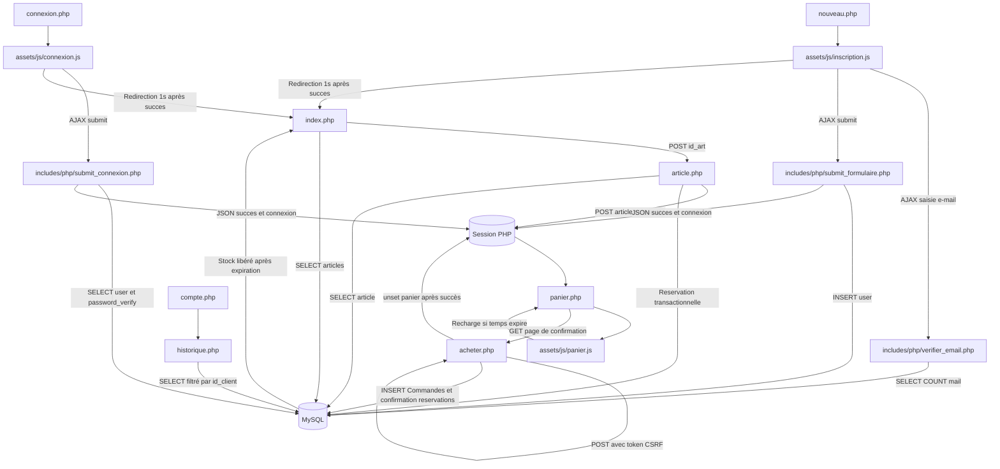

# Architecture de Frames & cores

## 1. Vue d'ensemble

Frames & cores est un site de vente de matériel informatique développé sans framework.
Les pages PHP rendent les vues et traitent directement les formulaires. PDO centralise
les échanges avec MySQL, tandis que les sessions PHP conservent l'identité du client et
son panier entre deux requêtes.

Technologies utilisées :

- **PHP 8.0 ou supérieur** pour le rendu serveur, les API AJAX, le filtrage de modération et la logique métier ;
- **JavaScript & jQuery 3.7+** pour les validations de formulaires, les requêtes AJAX asynchrones, le compte à rebours et le tchat en direct ;
- **Python 3 & scikit-learn** pour l'entraînement hors-ligne du perceptron et l'extraction des poids TF-IDF ;
- **MySQL** pour les articles, les utilisateurs, les réservations, les commandes et les messages de tchat ;
- **PDO** pour les requêtes préparées et les transactions ;
- **HTML5/CSS3** pour la structure, le responsive design, le widget de discussion et les indicateurs visuels ;
- **Sessions PHP** pour l'authentification, le panier et la protection CSRF.

Le code reste volontairement limité aux fonctionnalités communes à PHP 8.0, PHP 8.1,
PHP 8.2, PHP 8.3 et PHP 8.4. Les extensions `PDO_MySQL` et `mbstring` doivent être
activées sur le serveur.

Les commentaires placés dans les blocs PHP sont traités côté serveur. Ils documentent
le code source et ne sont donc pas envoyés dans le HTML généré.

## 2. Arborescence

```text
TyldenHounsa/
|-- index.php                         Catalogue et accueil
|-- article.php                       Fiche et ajout au panier
|-- panier.php                        Consultation et validation du panier (avec compte à rebours dynamique)
|-- acheter.php                       Enregistrement d'une commande
|-- historique.php                    Historique du client connecté
|-- compte.php                        Espace du client
|-- connexion.php                     Formulaire de connexion (gestion AJAX intégrée)
|-- nouveau.php                       Formulaire de création de compte (validation dynamique & AJAX)
|-- contact.html                      Page statique de contact
|-- ARCHITECTURE.md                   Documentation technique
|-- readme.md                         Présentation générale et installation
|-- TP7b.pdf                          Sujet des travaux pratiques (intégration AJAX)
|
|-- assets/
|   |-- css/style.css                 Feuille de style commune, formulaires et thème du tchat
|   |-- js/main.js                    Script principal commun
|   |-- js/panier.js                  Compte à rebours temps réel des réservations du panier
|   |-- js/inscription.js             Validation en direct des champs et inscription AJAX (TP 7B)
|   |-- js/connexion.js               Validation et connexion AJAX sans rechargement (TP 7B)
|   |-- js/chat.js                    Gestion du tchat en direct (polling, scroll et AJAX avec jQuery)
|   `-- images/                        Images des produits
|
|-- includes/data/
|   |-- model_weights.json            Dictionnaire des poids et biais du perceptron
|   `-- chat_config.json              Configuration optionnelle de la durée de vie des messages
|
|-- includes/filter/
|   |-- data/sampled_train/           Corpus de textes annotés
|   `-- model/train_filter.py         Entraînement TF-IDF + perceptron et export des poids
|
|-- includes/php/
|   |-- bd.php                        Connexion PDO à MySQL
|   |-- csrf.php                      Génération et validation des tokens CSRF
|   |-- reservation.php                Réservations, expiration et libération du stock
|   |-- verifier_email.php            API AJAX vérifiant la disponibilité d'un e-mail (TP 7B)
|   |-- check_email.php               Alias de redirection vers verifier_email.php
|   |-- submit_connexion.php          Traitement hybride (AJAX/POST classique) de la connexion
|   |-- submit_formulaire.php         Traitement hybride (AJAX/POST classique) de l'inscription
|   |-- disconnect.php                Fermeture de session
|   |-- chat_widget.php               Bulle HTML flottante du tchat
|   |-- chat_send.php                 Envoi AJAX, modération et insertion en base
|   |-- chat_fetch.php                Récupération AJAX des messages actifs et formatage
|   |-- chat_filter.php               Inférence O(m) du filtre de modération
|   `-- chat_config.php               Paramétrage de la rétention et fonction de purge
|
`-- database/
    `-- computer_database.sql         Schéma et données initiales (dont table chat_messages)
```

## 3. Flux applicatif



## 4. Parcours du catalogue et du panier

### Catalogue

`index.php` démarre la session, charge les articles depuis la table `articles` et
échappe les valeurs avant leur insertion dans le HTML. Chaque carte contient un
formulaire `POST` vers `article.php` avec les champs cachés `id_art` et
`csrf_token`.

La fiche n'est donc plus ouverte par une redirection JavaScript ou par un identifiant
placé dans l'URL.

### Fiche article

`article.php` récupère `id_art` depuis `$_POST`, puis recherche l'article avec une
requête préparée. Le formulaire d'ajout renvoie l'identifiant, l'action et la quantité.

Lors d'un ajout au panier, le serveur :

1. vérifie que le client est connecté ;
2. vérifie que la quantité est un entier positif ;
3. verrouille la ligne de l'article dans une transaction ;
4. vérifie le stock disponible ;
5. diminue le stock et crée ou met à jour une réservation active ;
6. fixe une date d'expiration selon la durée configurée.

La session conserve une copie d'affichage, mais la base est la source de vérité.
Les réservations actives du client constituent le panier réel :

```php
$_SESSION['panier'][id_art] = quantite;
```

### Panier

`panier.php` relit les réservations actives et les informations des articles depuis
MySQL. La session ne fait pas autorité pour les quantités, les prix ou le stock. La
page calcule chaque sous-total ainsi que le total général et affiche le temps restant
de chaque réservation.

Le bouton de suppression est traité par `panier.php` en `POST`. Il utilise
une transaction pour remettre les quantités réservées en stock, passe les
réservations à l'état `annulee`, vide la session, puis redirige vers la même page.

## 5. Authentification, inscription et interactions AJAX (TP 7B)

### Validation interactive côté client (jQuery)

Dans [`nouveau.php`](nouveau.php) et [`connexion.php`](connexion.php), l'utilisateur bénéficie d'un retour visuel instantané sans attendre la soumission du formulaire :

- **États visuels dynamiques :** dès la saisie ou la perte de focus (`input`, `change`, `blur`), chaque champ passe en vert (`#ccffcc` avec bordure verte `#28a745`) s'il est valide, ou en rouge (`#ffcccc` avec bordure rouge `#dc3545`) en cas d'erreur.
- **Messages explicatifs :** une courte phrase sous le champ (`.field-msg.erreur`) indique la cause exacte de l'invalidité.
- **Blocage préventif :** le bouton de soumission est désactivé (`disabled`) avec un curseur `not-allowed` et une opacité réduite tant que l'ensemble des critères n'est pas réuni.
- **Règles de validation :**
  - Nom, prénom, adresse et téléphone : champs non vides ;
  - Adresse e-mail : format valide (expression régulière RFC) et vérification d'unicité ;
  - Mot de passe : au moins 1 lettre, 1 chiffre et 1 caractère spécial (expression régulière `^(?=.*[a-zA-Z])(?=.*[0-9])(?=.*[^a-zA-Z0-9\s]).+$`) ;
  - Confirmation : correspondance exacte avec le premier mot de passe.

### Vérification d'unicité d'e-mail en AJAX

[`assets/js/inscription.js`](assets/js/inscription.js) interroge le point d'accès [`includes/php/verifier_email.php`](includes/php/verifier_email.php) (ou son alias [`includes/php/check_email.php`](includes/php/check_email.php)) en `GET` avec un délai d'attente (debounce de 300 ms).  
Le script PHP effectue un comptage préparé sur la table `user` (`SELECT COUNT(*) FROM user WHERE mail = :mail`) et renvoie un booléen lisible dans une réponse JSON (`existe`, `disponible`, `message`). Si l'adresse est déjà enregistrée, le champ est invalidé et la création de compte reste verrouillée.

### Création de compte et connexion asynchrones (sans rechargement)

- **Création de compte :** la soumission du formulaire d'inscription est interceptée via AJAX. Le fichier [`includes/php/submit_formulaire.php`](includes/php/submit_formulaire.php) détecte l'appel asynchrone, valide les données, hache le mot de passe avec `password_hash()`, insère la ligne dans la table `user`, et connecte immédiatement l'utilisateur en session. Il retourne un JSON confirmant l'opération. La page affiche alors un message de succès vert dans `#form-feedback` puis redirige automatiquement le client vers l'accueil (`index.php`) une seconde après (`setTimeout`).
- **Connexion :** [`assets/js/connexion.js`](assets/js/connexion.js) soumet les identifiants en AJAX vers [`includes/php/submit_connexion.php`](includes/php/submit_connexion.php). En cas de succès, la session est régénérée, l'identifiant client est stocké (`$_SESSION['id_client']`), et une redirection vers l'accueil s'opère après 1 seconde. En cas d'erreur, le message renvoyé par le serveur s'affiche en rouge sans recharger la page.
- **Compatibilité descendante :** les scripts de traitement PHP conservent leur logique de redirection classique (`header('Location: ...')`) si la requête ne provient pas d'AJAX, assurant ainsi un fonctionnement robuste même sans JavaScript.

```php
$_SESSION['id_client'] = (int) $utilisateur['id_user'];
$_SESSION['nom'] = $utilisateur['nom'];
$_SESSION['prenom'] = $utilisateur['prenom'];
```

`compte.php` est accessible uniquement lorsque le client est authentifié. Le lien vers `historique.php` lui permet de consulter l'état de ses commandes antérieures.

## 6. Protection CSRF

`includes/php/csrf.php` centralise la protection contre les requêtes intersites.
Les pages contenant une action génèrent un token aléatoire, placé dans le champ
caché `csrf_token` de leur formulaire. Le serveur vérifie ce token avant toute
modification de session ou de base de données.

La session conserve au maximum deux tokens valides. Lorsqu'un troisième token est
généré, le plus ancien est supprimé ; une page utilisant ce token reçoit alors une
réponse HTTP `403`. Les actions protégées sont l'inscription, la connexion, l'ajout
au panier, la suppression du panier, la déconnexion et la validation d'une commande.

## 7. Réservations temporaires

`includes/php/reservation.php` centralise les opérations de réservation et de
libération du stock. Les deux constantes suivantes permettent de modifier les durées
sans changer les traitements :

- `CART_RESERVATION_DURATION_SECONDS` : durée globale d'une réservation dans le panier ;
- `LAST_STOCK_RESERVATION_DURATION_SECONDS` : durée appliquée lorsque la réservation
  fait tomber le stock disponible à zéro.

Les deux valeurs sont exprimées en secondes. Par défaut, la durée globale est de
quinze minutes et la durée des derniers exemplaires est de cinq minutes.
Les dates de réservation sont enregistrées et comparées en UTC, à la fois par PHP et
par MySQL, afin d'éviter les expirations immédiates liées au fuseau horaire local.

## 8. Enregistrement d'une commande

`acheter.php` exige un `id_client` valide et au moins une réservation active. Une
requête `GET` affiche uniquement une page de confirmation. L'enregistrement réel est
déclenché par un formulaire `POST` contenant un token CSRF valide.

Le traitement utilise ensuite une transaction PDO :

1. les réservations actives du client sont verrouillées avec `SELECT ... FOR UPDATE` ;
2. chaque article est inséré dans `Commandes` avec `envoi = FALSE` ;
3. les réservations sont passées à l'état `confirmee` ;
4. le stock n'est pas décrémenté une seconde fois, car il l'a été lors de la réservation ;
5. la transaction est validée avec `commit()` ;
6. le panier de session est supprimé après cette validation.

En cas d'erreur, `rollBack()` annule les écritures réalisées pendant la transaction et
le panier reste disponible pour une nouvelle tentative.

Les réservations dépassant leur date d'expiration sont nettoyées avant les opérations
sur le catalogue, la fiche article, le panier et la commande. Leur quantité est
remise dans `articles.quantite` et leur statut devient `expiree`.

## 9. Historique des commandes

`historique.php` est réservé au client connecté. Sa requête filtre les lignes avec
`c.id_client = :id_client` et joint `articles` pour afficher le nom et le prix du
produit.

Le tableau présente :

- l'identifiant de commande ;
- l'article commandé ;
- la quantité ;
- le total de la ligne ;
- l'état d'envoi.

La colonne `envoi` vaut `FALSE` lors de l'achat et peut être passée manuellement à
`TRUE` par le gestionnaire.

## 10. Base de données

Le script `database/computer_database.sql` crée les tables `articles`, `user`,
`reservations` et `Commandes`. Les tables utilisant des relations sont en `InnoDB`.
Pour une base déjà installée, `database/add_reservations.sql` permet d'ajouter la
table `reservations` sans supprimer les données existantes.

Structure de `articles` :

| Colonne | Type | Rôle |
|---|---|---|
| `id_art` | `int` | Identifiant auto-incrémenté et clé primaire de l'article |
| `nom` | `varchar(150)` | Nom de l'article |
| `quantite` | `int` | Quantité disponible en stock, initialisée à `0` |
| `prix` | `float` | Prix de l'article |
| `url_photo` | `varchar(255)` | Chemin de l'image de l'article, facultatif |
| `description` | `text` | Description de l'article, facultative |

Structure de `user` :

| Colonne | Type | Rôle |
|---|---|---|
| `id_user` | `int UNSIGNED` | Identifiant auto-incrémenté et clé primaire du client |
| `nom` | `varchar(100)` | Nom du client |
| `prenom` | `varchar(100)` | Prénom du client |
| `adr` | `varchar(255)` | Adresse du client |
| `num` | `varchar(30)` | Numéro de téléphone du client |
| `mail` | `varchar(254)` | Adresse e-mail unique du client |
| `mdp` | `varchar(255)` | Mot de passe stocké sous forme de hash |

Structure de `reservations` :

| Colonne | Type | Rôle |
|---|---|---|
| `id_reservation` | `int` | Identifiant auto-incrémenté de la réservation |
| `id_client` | `int UNSIGNED` | Client qui possède la réservation |
| `id_art` | `int` | Article réservé |
| `quantite` | `int` | Quantité retirée temporairement du stock disponible |
| `date_reservation` | `datetime` | Date et heure de création |
| `date_expiration` | `datetime` | Date et heure auxquelles le stock est libéré |
| `statut` | `enum` | `active`, `confirmee`, `expiree` ou `annulee` |

La table possède des clés étrangères vers `user` et `articles`, ainsi que des index
sur l'article, le client, le statut et la date d'expiration.

Structure de `Commandes` :

| Colonne | Rôle |
|---|---|
| `id_commande` | Identifiant auto-incrémenté de la ligne commandée |
| `id_art` | Article commandé et clé étrangère vers `articles` |
| `id_client` | Client et clé étrangère vers `user` |
| `quantite` | Quantité commandée |
| `envoi` | État d'envoi, `FALSE` par défaut |

Chaque article d'un panier est enregistré sur une ligne distincte. La structure
conserve ainsi tous les champs demandés tout en permettant une commande composée de
plusieurs articles.

Structure de `chat_messages` :

| Colonne | Type | Rôle |
|---|---|---|
| `id_message` | `int` | Identifiant auto-incrémenté du message |
| `id_user` | `int UNSIGNED` | Auteur du message et clé étrangère vers `user` |
| `message` | `varchar(256)` | Texte du message (limité à 256 caractères) |
| `date_envoi` | `datetime` | Date et heure de publication du message |

## 11. Sécurité et intégrité

- Les requêtes utilisent des paramètres PDO afin d'éviter la concaténation de valeurs
  fournies par l'utilisateur.
- Les valeurs affichées sont échappées avec `htmlspecialchars()`.
- Les mots de passe sont hachés avec `password_hash()` et vérifiés avec
  `password_verify()`.
- L'identifiant de session est régénéré après une connexion réussie.
- Les actions qui modifient l'état utilisent des formulaires `POST` protégés par des
  tokens CSRF.
- Deux tokens CSRF au maximum sont conservés par session, selon une file FIFO.
- Les quantités et les identifiants sont validés côté serveur.
- Une commande ne peut pas être créée par une simple requête `GET`.
- La transaction de commande protège la cohérence entre `Commandes` et `articles`.
- La réservation verrouille l'article avec `FOR UPDATE` avant de diminuer le stock.
- Une réservation expirée restitue sa quantité au stock dans une transaction.
- Les données de la page d'historique sont filtrées par le client connecté.
- Les messages du tchat sont validés en longueur (256 caractères max) et filtrés par le modèle de modération avant insertion.

## 12. Messagerie instantanée et modération automatique

### Interface et interactions en direct (jQuery)

Le tchat général se présente sous la forme d'une bulle flottante accessible en bas à droite de l'écran sur l'ensemble des pages principales (`index.php`, `article.php`, `panier.php`, `compte.php`, `historique.php`). L'interface adopte la charte graphique sombre et dorée du site (`#ffcc00` et `#171717`).

- **Gestion asynchrone :** [`assets/js/chat.js`](assets/js/chat.js) exploite jQuery pour ouvrir la boîte de dialogue, récupérer périodiquement les nouveaux messages via `$.getJSON` (`includes/php/chat_fetch.php`) et soumettre les envois via `$.ajax` (`includes/php/chat_send.php`).
- **Expérience de lecture :** le défilement est isolé (`overscroll-behavior: contain` et interception de l'événement `wheel`) pour empêcher les gestes de défilement d'affecter la page en arrière-plan. L'auto-scroll vers le bas est suspendu dès que l'utilisateur remonte dans l'historique pour lire d'anciens messages.
- **Règles d'accès et format :** seuls les utilisateurs authentifiés (`$_SESSION['id_client']`) peuvent poster. La longueur est limitée à 256 caractères et l'affichage suit le format standardisé : `Auteur dit 'Message'`.

### Modération automatique (TF-IDF & Perceptron)

Afin d'empêcher la diffusion de messages inappropriés ou haineux, chaque message soumis passe par un filtre de décision avant insertion en base de données.

1. **Entraînement hors-ligne (`includes/filter/model/train_filter.py`) :**
   - Corpus d'entraînement équilibré de messages annotés (`hate` et `noHate`).
   - Vectorisation TF-IDF manuelle : extraction des tokens par expression régulière (`\b[a-zA-Z]{2,}\b`), calcul des fréquences documentaires et des scores IDF, puis conversion en matrice creuse `csr_matrix`.
   - Modèle Perceptron entraîné avec `sklearn.linear_model.Perceptron`.
   - Exportation des poids et du biais dans un fichier JSON compact ([`includes/data/model_weights.json`](includes/data/model_weights.json)).

2. **Inférence en temps constant côté serveur (`includes/php/chat_filter.php`) :**
   - Le serveur PHP charge le dictionnaire des poids en mémoire au premier appel.
   - Pour chaque message, les mots sont extraits et sommés avec le biais : score = $b + \sum w_i$.
   - L'opération s'exécute en complexité $O(m)$ par simple consultation de table de hachage, où $m$ est le nombre de mots du message, sans calcul matriciel lourd.
   - Si score $\ge 0$, le message est accepté. Si score $< 0$, le message est bloqué et une réponse HTTP `400` est retournée avec un message d'avertissement affiché directement dans le widget.

### Rétention et purge automatique des messages

La durée de vie des messages est centralisée dans [`includes/php/chat_config.php`](includes/php/chat_config.php) via la constante `CHAT_MESSAGE_LIFETIME_MINUTES` (fixée par défaut à 10 minutes).

- Une surcharge dynamique sans modification de code est supportée via le fichier optionnel `includes/data/chat_config.json`.
- La fonction `purgeExpiredChatMessages()` supprime automatiquement les messages dont la date d'envoi dépasse la durée de rétention lors de chaque lecture et de chaque envoi.

## 13. Évolutions possibles

- déplacer les identifiants MySQL de `bd.php` vers des variables d'environnement ;
- ajouter une gestion dédiée des lignes d'une même commande si un identifiant de
  commande commun doit être affiché pour plusieurs articles ;
- ajouter des tests automatisés pour le panier, le stock et la transaction ;
- ajouter une interface d'administration pour modifier `envoi`.
